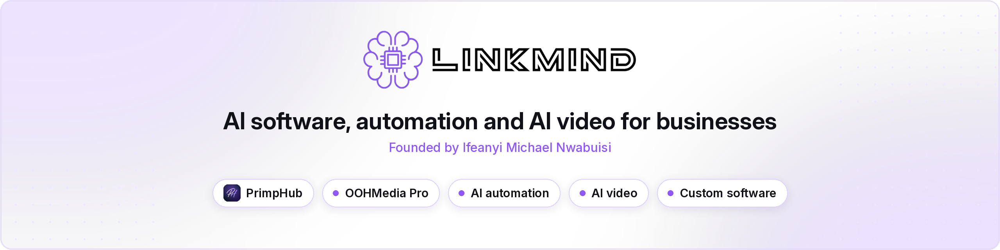
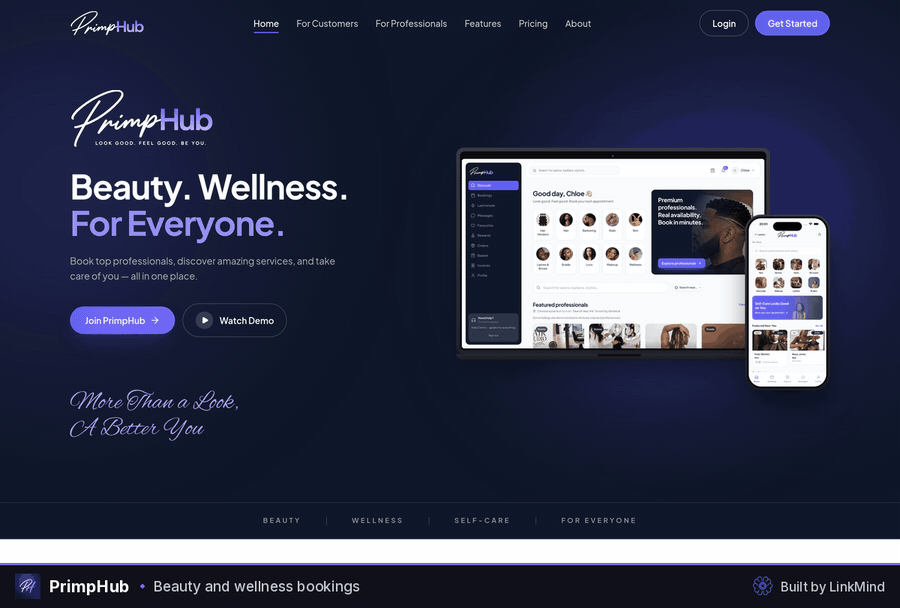
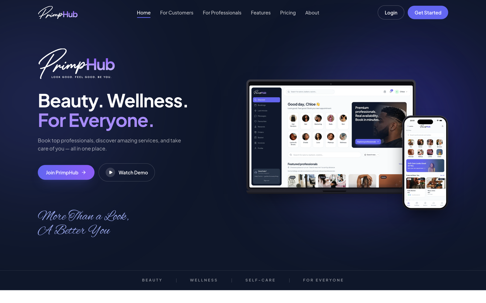
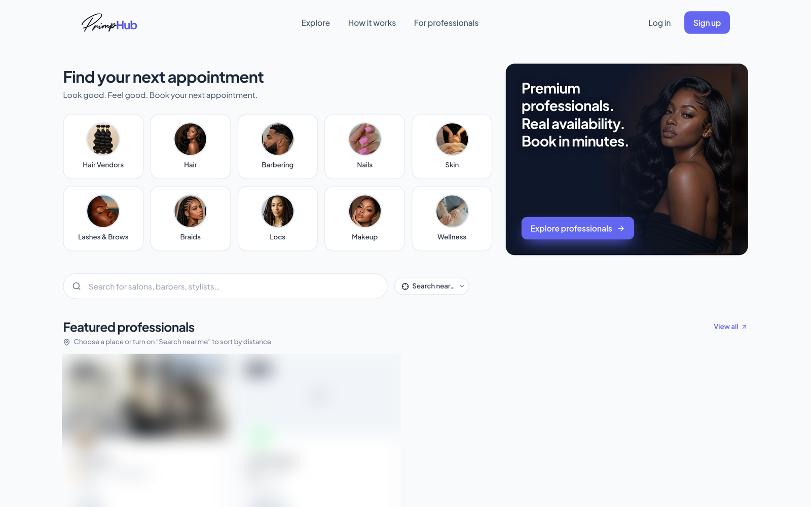
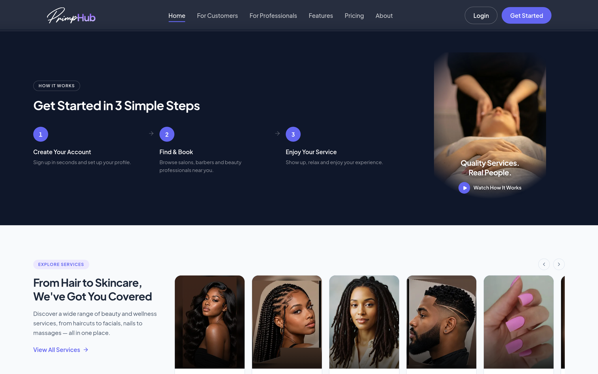
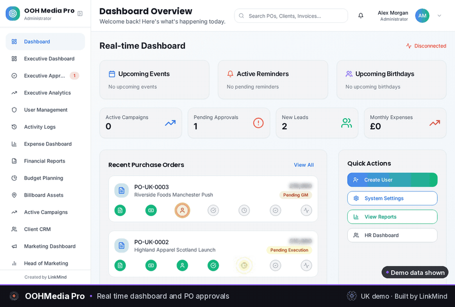
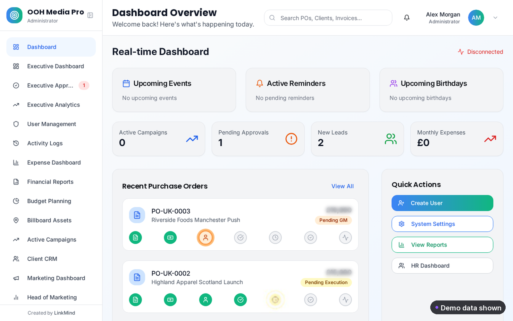
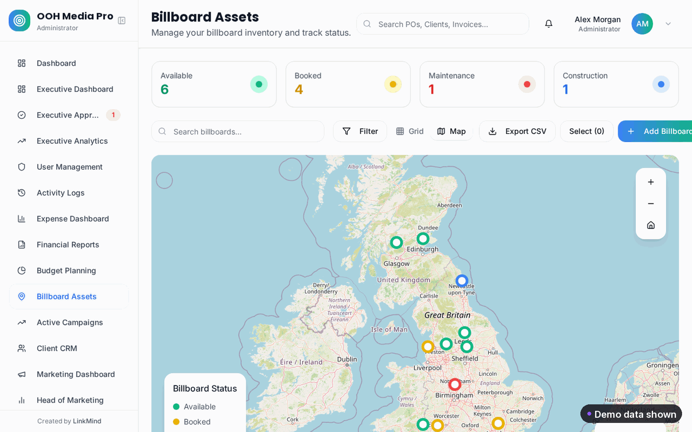
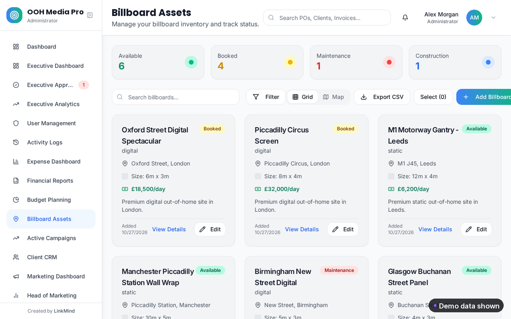

  

  
  
  

 

### What LinkMind does

**[LinkMind](https://linkmindhq.com)** is a London based software studio. We build AI software, business automation and AI video for businesses that want to spend less time on manual work and more time on the work that matters.

We build and run our own products too, so we know what it takes to turn an idea into software people actually use. If your team is held back by spreadsheets, repetitive admin or an app that never quite got finished, we'd love to hear about it.

 

### Products

<table>
<tr>
<td width="50%" valign="top">

#### PrimpHub
A beauty marketplace and salon platform that connects clients with beauty professionals. Clients discover and book appointments, and salons run their business in one place.

**Web live; iOS coming soon to the App Store**

[primphub.com](https://primphub.com)

</td>
<td width="50%" valign="top">

#### OOHMedia Pro
An ERP for out of home advertising agencies. Campaigns, sites and inventory, client records, invoicing and reporting, built around how outdoor agencies really work.

**Demo available on request**

[Request a demo](mailto:admin@linkmindhq.com?subject=OOHMedia%20Pro%20demo)

</td>
</tr>
</table>

 

### See it in action

#### PrimpHub

  

<table>
<tr>
<td width="33%" align="center"> Home</td>
<td width="33%" align="center"> Discover and book</td>
<td width="33%" align="center"> How it works</td>
</tr>
</table>

#### OOHMedia Pro

  

<table>
<tr>
<td width="33%" align="center"> Dashboard and approvals</td>
<td width="33%" align="center"> Inventory map</td>
<td width="33%" align="center"> Billboard assets</td>
</tr>
</table>

OOHMedia Pro screens show sample demo data, not real clients.

 

### Services

| | |
|:--|:--|
| **AI automation** | Take repetitive admin off your team's plate, from lead handling to reporting. |
| **Custom software** | Web and mobile apps designed around your process, not the other way round. |
| **Business systems** | ERP, CRM and internal tools that replace scattered spreadsheets. |
| **AI ads and UGC videos** | Presenter ads, product spots and UGC style reviews for your social channels. |

 

### Tech stack

  
  
  
  
  
  
  
  
  
  
  
  
  

 

 

### Work with us

Got a process you'd like to automate, a product idea, or a campaign that needs AI video? Send us a message and tell us what you're working on. Our founder, Ifeanyi Michael, reads every message and will get back to you.

  <a href="https://linkmindhq.com"><b>linkmindhq.com</b></a> &nbsp;·&nbsp;
  <a href="mailto:admin@linkmindhq.com"><b>admin@linkmindhq.com</b></a> &nbsp;·&nbsp;
  <a href="https://www.linkedin.com/company/linkmind-limited/"><b>LinkMind on LinkedIn</b></a>

  Founder: <a href="https://github.com/sirmike6277-dot"><b>Ifeanyi Michael on GitHub</b></a> &nbsp;·&nbsp;
  <a href="https://www.linkedin.com/in/ifeanyi-michael-n/"><b>Ifeanyi Michael on LinkedIn</b></a>

 

  

